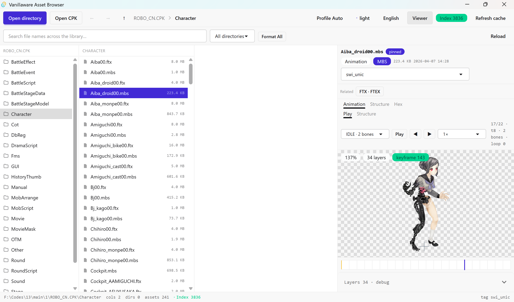

# Vanillaware Asset Browser

[中文](README.zh-CN.md)

A read-only local asset browser for the native binary resources of two Vanillaware
games: textures, animations, scenes, models, battlefield maps, scripts, text,
tables, meshes, audio, movies, and mountable CPK archives.

It is not a general unpacker: it only shows native game resources registered in
the format registry. Everything else is counted under "uncatalogued" and hidden.



## Support scope

| Item | Status |
| --- | --- |
| **UNICORN OVERLORD** (Switch) | Verified |
| **13 Sentinels: Aegis Rim** (Switch, internal codename ROBO) | Verified |
| PS4 / PS5 and other platform profiles | Opens, but **unverified**; the UI shows an "unverified" badge whenever the selected `tag` is not `swi_*` |

## Supported formats

Only native game binary resources are catalogued; derived artifacts (`.png`,
`.json`, `.txt`, …) are filtered out of listings. The table below mirrors the
backend format registry, grouped by kind. Formats whose business purpose is not
recovered yet say so honestly — their byte structure is already closed.

### Texture

| Extension | Format | Purpose | Viewers |
| --- | --- | --- | --- |
| `.ftx` `.ftp` | FTEX | Compressed pixel frames (BC7 / BC4 on Switch). Paired `.mbs` files resolve their textures here. Some single-solid-color pages are vertex-tinted by the game — that is real data, not a decode failure. | Atlas, Structure, Hex |

### Animation

| Extension | Format | Purpose | Viewers |
| --- | --- | --- | --- |
| `.mbs` `.mbp` | MBS | Skeleton-quad animation data organized into sections (`s0..sb`); section meaning follows the platform `tag`. Drives the animation player and the prop layers of battlefield maps. | Animation, Structure, Hex |

### Scene

| Extension | Format | Purpose | Viewers |
| --- | --- | --- | --- |
| `.osb` | OSB | 13 Sentinels stage bundle: a resource path pool plus a node tree. `.oeb` and `.orb` share the same layout. | Scene, Structure, Hex |
| `.bbs` | BBS | Battle stage: two fixed-slot name tables pointing at sibling `.mbs`/`.ftx`; carries plates, fog quads and camera routes. | Layout, References, Structure, Hex |
| `.oeb` | OEB | OSB-family placement container. | Content, Structure, Hex |
| `.bst` | BST | A tagged value stream: one type byte plus a fixed payload per value, closing with `0x34` — a different writer from the OSB node tree. | Content, Structure, Hex |
| `.ufb` | UFB | Field placement: layers stored on a 138 × 105 tile grid describing what stands in that patch of world; also carries area masks and name pools. | Field, Structure, Hex |

### Grid

| Extension | Format | Purpose | Viewers |
| --- | --- | --- | --- |
| `.otm` | OTM | Fixed header plus a resource-name table. Purpose not yet identified. | References, Structure, Hex |
| `.mpd` | MPD | Placement-set panels: page quads with atlas UVs that texture the battlefield map. | Content, Structure, Hex |
| `.ctb` | CTB | Grid-shaped records. Purpose not yet identified. | Content, Structure, Hex |
| `.nnd` | NND | Word table plus 110 place-name slots. The meaning of the three words is not closed yet. | Content, Structure, Hex |
| `.ucb` | UCB | The world grid: 2199 × 1311 cells, each naming the area and terrain class it belongs to. Carries no pixels — the rasterized result of the UFB area masks. | Field, Structure, Hex |

### List

| Extension | Format | Purpose | Viewers |
| --- | --- | --- | --- |
| `.fsb` | FSB | Tabular records. Purpose not yet identified. | Content, Structure, Hex |
| `.orb` | ORB | OSB-family round container. | Content, Structure, Hex |
| `.drg` | DRG | Debug-console command database: 96 databases × 6559 command records, each a 64-byte name plus a 144-byte Japanese description. | Content, Structure, Hex |
| `.vs2` | VS2 | Tabular records. Purpose not yet identified. | Content, Structure, Hex |

### Script

| Extension | Format | Purpose | Viewers |
| --- | --- | --- | --- |
| `.asb` | ASB | Script bytecode. Projected into mnemonics with cross-table notes (call targets, globals, jump labels) and readable pseudo-code. | Disassembly, Structure, Hex |
| `.rsc` | RSC | Scene scripts: entries point into the FMS text pool; commands form dialogue flows. | Dialogue, References, Structure, Hex |

### Text

| Extension | Format | Purpose | Viewers |
| --- | --- | --- | --- |
| `.fms` | FMS | Text pool: a string count plus length-prefixed strings. Dialogue text lives in `Fms/ScriptText.fms`; `.rsc` entries index into it. | Text, Structure, Hex |
| `.inc` | INC | Text-shaped records. Purpose not yet identified. | Content, Structure, Hex |
| `.scb` | SCB | Token-stream text: a counted name table followed by `ROOT { @TYPE (…) { … } }` blocks. | Content, Structure, Hex |

### Model

| Extension | Format | Purpose | Viewers |
| --- | --- | --- | --- |
| `.fmd` | FMD | 3D mesh: draw segments with vertex ranges and triangle counts, shown as shaded/wireframe slices. | Mesh, Structure, Hex |

### Audio

| Extension | Format | Purpose | Viewers |
| --- | --- | --- | --- |
| `.acb` | ACB | CRI ADX2 cue sheet naming the tracks; payload may live in a sibling AWB. | Audio, Structure, Hex |
| `.awb` | AFS2 | CRI ADX2 wave bank. Entries are HCA or CRI Opus (lopus) and must be sniffed per entry — some banks mix both. | Audio, Structure, Hex |
| `.acf` | ACF | CRI ADX2 global configuration table. | Content, Structure, Hex |

### Video

| Extension | Format | Purpose | Viewers |
| --- | --- | --- | --- |
| `.usm` | USM | CRI Sofdec2 movie container. Frames are fetched per GOP, never whole-file. | Video, Structure, Hex |

### Archive

| Extension | Format | Purpose | Viewers |
| --- | --- | --- | --- |
| `.cpk` | CPK | CRI archive: `@UTF` header table plus TOC, XOR-encrypted, CRILAYLA-compressed entries. Mounted as a virtual directory, not shown as a resource. | Overview, Structure, Hex |

## Development

Frontend Tauri v2 + React 19 + Tailwind 4 + daisyUI 5, backend Rust.

```bash
pnpm install
pnpm tauri dev
pnpm build
```

## References

- [Web2D_Games](https://github.com/rufaswan/Web2D_Games) — Vanillaware ripping tools
- [CriFsV2Lib](https://github.com/Sewer56/CriFsV2Lib) — CPK library

