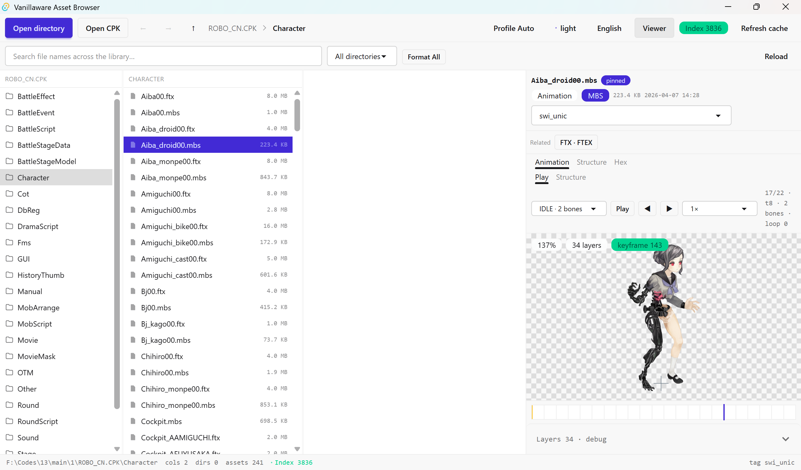

# Vanillaware 资源浏览器

[English](README.md)

一个只读的本地资源浏览器，用于查看 Vanillaware 两款游戏的原生二进制资源：
纹理、动画、场景、模型、战场地图、脚本、文本、列表、网格、音频、影片，以及可挂载的 CPK 归档。

它不是通用解包器：只显示登记在格式注册表里的原生游戏资源，其余文件只计入「未收录」数量。



## 支持范围

| 项目 | 状态 |
| --- | --- |
| **UNICORN OVERLORD**（Switch） | 已验证 |
| **13 Sentinels: Aegis Rim**（Switch，内部代号 ROBO） | 已验证 |
| PS4 / PS5 等其它平台档案 | 可以打开，但**未验证**；选中非 `swi_*` 的 `tag` 时界面会挂「未经验证」徽标 |

## 功能

- **列视图浏览**：Finder 风格的分栏视图，右侧固定预览栏；单击看元信息，双击装载查看器。
- **CPK 归档**：`打开归档` 选中一个 `.cpk` 后即可像目录一样进入，按需解包单条资源；
  自洽格式零写盘，需要同目录邻居的格式（`.mbs`+`.ftx`、`.acb`+`.awb`、`.usm` 等）按目录投影到缓存盘。
  归档概览面板给出条目数、目录数、压缩占比、表偏移与加密情况。
- **查看器**：图集、骨骼动画播放、文档树、内容视图（表 / 位图 / 折线 / 文本）、
  反汇编与伪代码、对话、音频（HCA 后端解码 + lopus 交前端 WebCodecs）、
  USM 影片（按 GOP 取流）、3D 网格、场景图、战场地图、引用关系图、十六进制。
- **战场地图（UFB/UCB）**：按引擎口径分层渲染——面板层贴配对 `.mpd`/`.ftx`，
  道具层取配对 `.mbs` 的骨架姿势（引擎时钟逐 tick 采样）；
  每张图给出层数、面板数、道具清单与未解析计数，预览说明里写明世界窗口与绘制规则。
- **骨骼动画（MBS）**：播放与引擎一致——每 tick 1/60 s，关键帧插值三态
  （直取 / 线性 / Catmull-Rom），雾色随时间线混合，绘制按图层序不排序。
- **全局搜索**：后台建立的目录索引，覆盖磁盘目录与已挂载归档内部条目。
- **格式过滤**：按扩展名筛选当前列。
- **界面语言**：默认英语，工具栏一键切换中文；偏好存 `localStorage["locale"]`。

## 支持的格式

只有登记在注册表里的原生资源才被收录；派生产物（`.png`、`.json`、`.txt` 等）
在目录列表里被过滤掉。下表与后端格式注册表一一对应，按语义类别分组。
业务用途尚未还原的格式如实标注——它们的字节结构均已闭合。

### 纹理

| 扩展名 | 格式 | 用途 | 查看器 |
| --- | --- | --- | --- |
| `.ftx` `.ftp` | FTEX | 压缩像素帧（Switch 上是 BC7 / BC4）。配对 `.mbs` 的纹理从这里解析。部分整幅同色页是游戏靠顶点色染色的真实数据，不是解码失败。 | 图集、结构、十六进制 |

### 动画

| 扩展名 | 格式 | 用途 | 查看器 |
| --- | --- | --- | --- |
| `.mbs` `.mbp` | MBS | 骨骼-四边形动画数据，按分节（`s0..sb`）组织；分节含义随平台 `tag` 变化。驱动动画播放器与战场地图的道具层。 | 动画、结构、十六进制 |

### 场景

| 扩展名 | 格式 | 用途 | 查看器 |
| --- | --- | --- | --- |
| `.osb` | OSB | 13 Sentinels 舞台容器：资源路径池 + 节点树。`.oeb` 与 `.orb` 共用同一布局。 | 场景、结构、十六进制 |
| `.bbs` | BBS | 战斗关卡：两张定长槽名表指向同目录 `.mbs`/`.ftx`；带碰撞板、雾区四边形与相机轨迹。 | 布局、引用、结构、十六进制 |
| `.oeb` | OEB | OSB 家族的站位容器。 | 内容、结构、十六进制 |
| `.bst` | BST | 带类型标签的值流：1 字节类型 + 定长载荷，`0x34` 收尾——与 OSB 节点树是两套写法。 | 内容、结构、十六进制 |
| `.ufb` | UFB | 战场摆放：图层存在 138 × 105 瓦片网格上，描述「这一小块世界摆了些什么」；同时携带区域掩码与名字池。 | 战场、结构、十六进制 |

### 网格

| 扩展名 | 格式 | 用途 | 查看器 |
| --- | --- | --- | --- |
| `.otm` | OTM | 定长头 + 资源名表。用途尚未还原。 | 引用、结构、十六进制 |
| `.mpd` | MPD | 放置集面板：带图集 UV 的页面四边形，给战场地图提供贴图。 | 内容、结构、十六进制 |
| `.ctb` | CTB | 网格状记录。用途尚未还原。 | 内容、结构、十六进制 |
| `.nnd` | NND | 词表 + 110 个地名槽。三个词的含义尚未闭合。 | 内容、结构、十六进制 |
| `.ucb` | UCB | 世界栅格：2199 × 1311 个格子，每格记「属于哪片区域、哪类地貌」。不含像素——是 UFB 区域掩码栅格化的结果。 | 战场、结构、十六进制 |

### 列表

| 扩展名 | 格式 | 用途 | 查看器 |
| --- | --- | --- | --- |
| `.fsb` | FSB | 表状记录。用途尚未还原。 | 内容、结构、十六进制 |
| `.orb` | ORB | OSB 家族的轮次容器。 | 内容、结构、十六进制 |
| `.drg` | DRG | 调试控制台命令数据库：96 个数据库 × 6559 条命令记录，每条 64 字节名字 + 144 字节日文说明。 | 内容、结构、十六进制 |
| `.vs2` | VS2 | 表状记录。用途尚未还原。 | 内容、结构、十六进制 |

### 脚本

| 扩展名 | 格式 | 用途 | 查看器 |
| --- | --- | --- | --- |
| `.asb` | ASB | 脚本字节码。投影成助记符 + 跨表注记（调用目标、全局、跳转标签）与可读伪代码。 | 反汇编、结构、十六进制 |
| `.rsc` | RSC | 场景脚本：条目指向 FMS 文本池；命令构成对话流。 | 对话、引用、结构、十六进制 |

### 文本

| 扩展名 | 格式 | 用途 | 查看器 |
| --- | --- | --- | --- |
| `.fms` | FMS | 文本池：字符串计数 + 定长前缀字符串。对话文本在 `Fms/ScriptText.fms`，`.rsc` 条目按下标引用。 | 文本、结构、十六进制 |
| `.inc` | INC | 文本状记录。用途尚未还原。 | 内容、结构、十六进制 |
| `.scb` | SCB | 令牌流文本：计数名字表 + `ROOT { @TYPE (…) { … } }` 块。 | 内容、结构、十六进制 |

### 模型

| 扩展名 | 格式 | 用途 | 查看器 |
| --- | --- | --- | --- |
| `.fmd` | FMD | 3D 网格：按绘制段给出顶点区间与三角数，可着色 / 线框查看。 | 网格、结构、十六进制 |

### 音频

| 扩展名 | 格式 | 用途 | 查看器 |
| --- | --- | --- | --- |
| `.acb` | ACB | CRI ADX2 cue 表，给出轨道名；载荷可能在同目录的 AWB 里。 | 音频、结构、十六进制 |
| `.awb` | AFS2 | CRI ADX2 波形库。条目是 HCA 或 CRI Opus（lopus），必须逐条嗅探——有的库两种混装。 | 音频、结构、十六进制 |
| `.acf` | ACF | CRI ADX2 全局配置表。 | 内容、结构、十六进制 |

### 影片

| 扩展名 | 格式 | 用途 | 查看器 |
| --- | --- | --- | --- |
| `.usm` | USM | CRI Sofdec2 影片容器。按 GOP 取帧，从不整段读入。 | 影片、结构、十六进制 |

### 归档

| 扩展名 | 格式 | 用途 | 查看器 |
| --- | --- | --- | --- |
| `.cpk` | CPK | CRI 归档：`@UTF` 头表 + TOC，XOR 加密，条目 CRILAYLA 压缩。作为虚拟目录挂载，不当作资源展示。 | 概览、结构、十六进制 |

## 开发

前端 Tauri v2 + React 19 + Tailwind 4 + daisyUI 5，后端 Rust。

```bash
pnpm install
pnpm tauri dev          # 开发
pnpm build              # 前端类型检查 + 构建
```

## 验收

```bash
# Rust
cargo test -p archive                                  # CPK 读取器
cargo test -p archive --test corpus -- --ignored       # 四个真实 CPK 的字节级闭合
cargo test -p vfs                                      # 挂载层
cargo test -p vfs --test corpus -- --ignored           # 真实归档的列举与索引
cargo test -p catalog -p formats -p media              # 格式与媒体回归
cargo test -p formats --test field_corpus -- --ignored # 战场地图语料闭合
cargo test --test archive_mount                        # 归档到查看器链路的端到端
cargo run -p archive --example cpk_probe -- <x.cpk>    # 归档诊断，有 FAIL 非零退出

# 前端
pnpm check:lang                                        # 代码里不得出现中文
pnpm check:audio                                       # 音频解码链路（HCA / lopus）
pnpm check:video                                       # USM 影片解码链路
pnpm check:mbs                                         # MBS 播放语义（插值 / 帧序）
npx tsc --noEmit
```

语料路径可用 `CPK_CORPUS`、`CORPUS_13`、`CRIFS_ASSETS` 等环境变量覆盖，
默认值写在对应 `tests/*.rs` 的常量里。

## 结构

```
src-tauri/
├── src/                 应用层：command（薄命令层）/ service（业务与缓存）/ model（DTO）
└── crates/
    ├── catalog          目录列举、格式注册表、索引、游戏档案（刻意不依赖 formats）
    ├── formats          格式语义与投影（文档树、内容视图、纹理解码、反汇编…）
    ├── archive          CRI CPK 读取器（容器 / @UTF 表 / TOC / CRILAYLA）
    ├── vfs              归档挂载层：一个路径同时寻址磁盘与归档
    ├── media            PNG 缓存、音频、影片、内容视图的媒体包装
    └── schema           Kaitai 生成的结构定义
src/                     前端：views / components（columns、library、viewers）/ store / lib / i18n
tools/                   ksc_gen.py（ksy → Kaitai 代码生成）与 rev/（NSO 解包、函数摘取、ADRP+ADD 引用还原等逆向辅助）
```

设计决策见 `docs/adr/`，领域术语见 `CONTEXT.md`。

## 参考项目

- [Web2D_Games](https://github.com/rufaswan/Web2D_Games) —— Vanillaware 引擎重实现与抽取工具
- [CriFsV2Lib](https://github.com/Sewer56/CriFsV2Lib) —— CRI 文件系统（CPK）读写库

